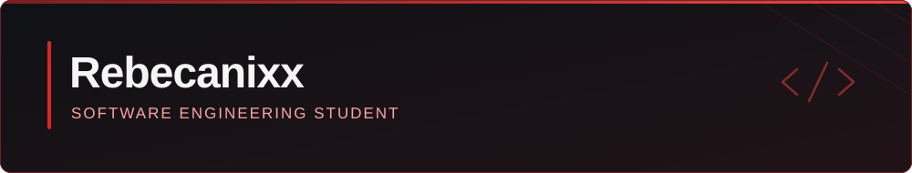

<!-- HEADER -->

  

 

<!-- ABOUT ME -->

## About me

Software Engineering student from Brazil with an interest in software development, technology and problem-solving.

Focused on building practical projects and developing a solid foundation in programming.

 

<!-- TECHNOLOGIES -->

## Languages & Technologies

### Development tools

 

<!-- PROJECTS -->

## Projects

A collection of personal and academic projects focused on software development and practical problem-solving.

[Explore my repositories](https://github.com/Rebecanixx?tab=repositories)

 

<!-- FOOTER -->

---

  <samp>每天进步一点点。</samp>
   
  Learn. Build. Improve.

